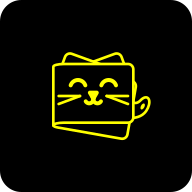

<div align="center">



# 白い熊 猫管 (shiroikuma-nekokan)

**Loyalty cards, membership cards, coupons — in the black-yellow 白い熊 house style.**

A fork of [Catima](https://github.com/CatimaLoyalty/Android) with **major additions**: one-tap full export/import (cards + theme + fonts + settings, by category), headless backup on request for automation, backup-and-restore of the app's own data by a sister app so a wiped phone comes back whole, the black-yellow theme applied to every surface with **every colour a settable role** (76 of them, each with its own RGBA picker, on a folding 白い熊 猫管 UI page with a chip index), outlined pill buttons, outlined switches and pill menus throughout, external fonts, border/roundness sliders, the black-yellow traced icon, a full Japanese translation of everything the fork adds, complete rebranding across all 54 locales, and **not a single tracker** — upstream's crash reporter is removed, not merely switched off.

Installs **side-by-side** with Catima (app id `shiroikuma.nekokan`).

**📥 Latest release: [`2.46.0+002`](https://github.com/ShiroiKuma0/shiroikuma-nekokan/releases/latest)** — [all releases & APK downloads »](https://github.com/ShiroiKuma0/shiroikuma-nekokan/releases)

</div>

---

## 📦 One-tap full backup — export / import everything
The first section of the UI page. Pick a backup directory once and one tap exports **everything** as a single zip — all cards (the complete Catima export with images), every 白い熊 猫管 UI setting including your imported fonts, and the app settings — split into selectable categories. The page itself shows a "Last export" freshness line (red until you've backed up), the run has a live n/total progress dialog with per-card ticks and a working Cancel, and import merges category-wise — never wipes — with a restart offer at the end.

## 🤖 Backup on request — the automation contract
The same backup, headlessly. A broadcast makes the app export itself with no window ever opening — one ZIP, written either to its own directory or to an absolute path the caller names — and reply with the real path and byte size, so a task on the phone can back this app up unattended alongside its sister apps. Progress comes back as **real counts, never a percentage** (`項目 123/456 — All cards`), naming the category being written so a backup panel can light up the right row. The caller is told which categories exist, which are sub-options of which, **and which ones this app says should start ticked**, so a backup picker never has to guess. A running export can be **stopped from outside**: the cancel unwinds it at the next entry boundary, deletes the partial file so the backup folder is left exactly as it was found, and reports `cancelled` — and it is harmless to send when nothing is running.

The automation ships **on**, in the Export/Import section right below the export rows. That is deliberate: a phone that has just been wiped has nothing configured on it, so a gate that needed setting up first would be no use for setting the phone up. **「Use authorization token?」 turns the older behaviour back on** — a tap-to-copy secret every caller must present — and the row says plainly what leaving it off means for *this* app, whose backup is scannable card barcodes rather than a settings dump. A token sent to the app while it is not asking for one is quietly ignored rather than refused, so a caller configured last year never mysteriously fails.

## 🔐 Restoring a wiped phone — the data door
Without root, nobody can reach another app's data, which is why a phone rebuilt from a backup normally comes back with its apps installed and empty. This fork opens a door for that: a sister app can ask 猫管 for its **own** backup and hand it back later, so the wallet returns with its cards rather than as a fresh install.

It is a narrow door, and it is the half that is **not** unauthenticated. The caller is identified by the framework, not by a shared secret, and checked three ways — its exact package name (never a `shiroikuma.*` prefix: package names are not a namespace anyone owns, and any sideloaded app may take one that is currently uninstalled), the uid the kernel reports for it, and a **pinned signing certificate**. The backup itself travels through a file descriptor the caller opens, so this app never writes into someone else's directory and the permission expires when the file is closed. **Restoring is only possible here** — never over the open broadcast — because an import overwrites your cards.

## 📸 Card photos: selectable, never silently dropped
Your card photographs are usually most of a backup's size, so there is a checkbox for them — a **sub-option under "All cards"**, in the app's own panel and in any automation picker alike. Untick it and you get a barcodes-only backup: small, fast, and complete as far as the card data goes.

It defaults **on** and always will. The test for starting a category unticked is that it is large, *derived* **and** re-creatable — a thumbnail cache, a re-downloadable map tile. A photo you took of a physical card is none of those: nothing can make it again. So it is offered, never assumed away. The choice is honoured in both directions, too — unticking it on import strips the images out of the archive rather than quietly restoring them, so the checkbox means the same thing whichever way the data is moving.

## 🚫 Zero trackers — the crash reporter is gone
Stock Catima ships the open source crash reporter ACRA: benign in behaviour — it never sends
anything by itself, it opens a mail draft you review first, and a switch turns even the asking off —
but its classes sit in the app, and every tracker scanner matches them. So this fork does not
disable it, it **removes** it: the dependency, the initialisation, the settings switch and the
About-page credit are all gone, and the built APK's dex contains no occurrence of the word `acra`.
There is no crash reporting and no analytics of any kind, and the app's own privacy policy says so.

## 🎨 The 白い熊 猫管 UI page — every colour is yours
One page controls the whole look — reachable from Settings or by **long-pressing the ⋮ button** on the main screen. It opens with a pill to the app settings and an **index of chips**, one per section: tap a chip to unfold its section and jump there, long-press to drag it, and the sections reorder to match. Every section folds, carries its own icon and colour, and remembers its state.

Nothing in the app has a fixed colour. **76 roles** — each kind of text, frame, ground, icon, divider and control state — sit in the section of the thing they paint: Foundation, Text, Buttons, Top bar, Dialogs, Main screen, Switches, Menus, Lists, Marks, Fields, Settings pages, Bars and messages. Every one opens a picker with **four RGBA sliders**, a live hex + swatch preview and boxes of your recent colours; each can be reset alone, or all at once. The two foundation colours cascade, so changing the accent once moves everything that has not been set separately. The roles travel in the export.

## 🔤 External fonts, rendered in their own glyphs
Import any `ttf`/`otf` and assign it per role — primary text, secondary text, bar title, welcome view, card name/note, buttons — each with its own weight (100–900) and size slider, and a live sample line. The font list draws every font's name **in that font**.

## 🖤💛 Black-yellow everywhere
The whole app is in the house look, on every screen — upstream's included. **Buttons are outlined pills**, never filled: a thick bold frame for the main action of a block, a thin one for the rest, red for anything that deletes. **Switches are outlined** with a solid dot. **Menus are full-width pill rows**, each with an icon coloured by what the row does — open, write, group, share, view, block, delete. Dialogs, lists, the settings screen (an icon on every row), the add button, tabs, toasts and the Compose screens all follow. Card frames have colour, **thickness and corner-roundness sliders that go all the way to 0**, with a live preview box. Upstream's Theme list and OLED switch are gone — the UI page replaces them.

## 🇯🇵 Japanese throughout
Every string the fork adds — the whole UI page, the export/import panel, the automation rows, the dialogs — has a proper Japanese translation, so nothing English sits between Japanese lines.

## 🐱 The traced icon
The Catima cat-card glyph re-traced as pure-yellow line art on black — hidden edges properly removed — as an adaptive icon, the splash screen, the welcome logo and the widget preview.

---

## Built on Catima
A fork of [Catima](https://github.com/CatimaLoyalty/Android) (app id `shiroikuma.nekokan`, so it coexists with the official build). Catima is Sylvia van Os's copylefted libre loyalty-card wallet — all card handling, barcode scanning and import/export machinery is hers. The code remains under **GPL-3.0-or-later**.

## Building
```bash
git clone git@github.com:ShiroiKuma0/shiroikuma-nekokan.git
cd shiroikuma-nekokan
export JAVA_HOME=/usr/lib/jvm/java-21-openjdk-amd64 ANDROID_HOME=~/android-sdk
./gradlew buildApk        # signed foss release → ~/tmp/shiroikuma-nekokan_<version>+<nnn>_arm64-v8a.apk
```
Versioning: `versionName = <upstream>+<build, zero-padded to 3 digits>`, `versionCode = upstreamCode * 10000 + build`. `main` tracks upstream release tags; all fork work lives on `custom`.
